# Posterior for the coin with a flat prior

Chapter 3 notes. **Task:** the prior over the head probability $$r$$ is flat, $$p(r)=1$$ for $$0<r<1$$. Find the posterior $$p(r\mid y)$$ after observing $$y$$ heads in $$N$$ tosses.

## Bayes' rule up to a constant

$$
p(r\mid y) = \frac{p(y\mid r)\,p(r)}{p(y)} \;\propto\; p(y\mid r)\,p(r).
$$

The denominator $$p(y)=\int p(y\mid r)p(r)\,dr$$ has $$r$$ integrated out, so it does not depend on $$r$$. As a function of $$r$$, the posterior has the shape of likelihood times prior, and the constant can be recovered at the end.

## The two factors

- **Prior.** $$p(r)=1$$. Multiplying by it changes nothing.
- **Binomial likelihood.** The binomial formula, with the observed $$y$$ and $$N$$ held fixed and read as a function of $$r$$:

$$
p(y\mid r) = \binom{N}{y} r^{y}(1-r)^{N-y}.
$$

As a probability, this formula is a distribution over the count $$y$$ for a known $$r$$. As a likelihood, it asks how well each possible $$r$$ explains the data you saw. It is not a density over $$r$$ and does not integrate to 1.

## Rearranging

Drop everything that does not contain $$r$$. The binomial coefficient $$\binom{N}{y}$$ goes into the constant:

$$
p(r\mid y) \;\propto\; r^{y}(1-r)^{N-y}.
$$

A beta density is proportional to $$r^{a-1}(1-r)^{b-1}$$. Matching exponents:

$$
a-1 = y \;\Rightarrow\; a = y+1, \qquad b-1 = N-y \;\Rightarrow\; b = N-y+1.
$$

The shape is that of a beta density, so the normalising constant must be the beta one, $$\Gamma(a+b)/(\Gamma(a)\Gamma(b))$$ with $$a+b=N+2$$. There is no need to compute $$p(y)$$:

$$
\boxed{\;p(r\mid y) = \frac{\Gamma(N+2)}{\Gamma(y+1)\,\Gamma(N-y+1)}\; r^{y}(1-r)^{N-y}\;}
$$

This is a $$\mathrm{Beta}(y+1,\;N-y+1)$$ density.

## Checks

- **General conjugacy.** The beta prior $$\mathrm{Beta}(\alpha,\beta)$$ with a binomial likelihood gives $$\mathrm{Beta}(\alpha+y,\;\beta+N-y)$$. With $$\alpha=\beta=1$$ this is the result above.
- **No data** ($$N=0$$, $$y=0$$). Both exponents are 0 and the constant is $$\Gamma(2)/(\Gamma(1)\Gamma(1))=1$$, so the posterior is flat, the same as the prior.
- **All heads** ($$y=N$$). The density is proportional to $$r^N$$, which leans toward $$r=1$$.
- **Pseudo-counts.** The flat prior counts as one imagined head and one imagined tail. The posterior parameters are the observed counts plus one each.

## Picture

The flat line is the prior. One head tilts the density toward large $$r$$ but leaves it wide. With more tosses the density narrows around the observed fraction of heads. The more data, the less the flat prior matters.
